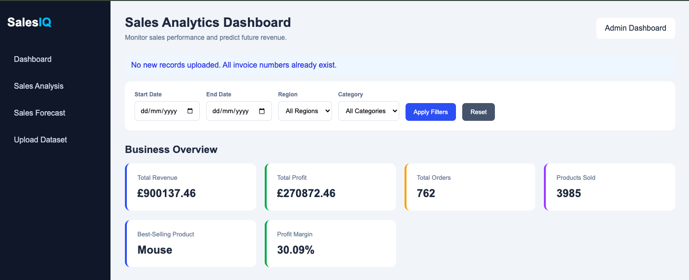
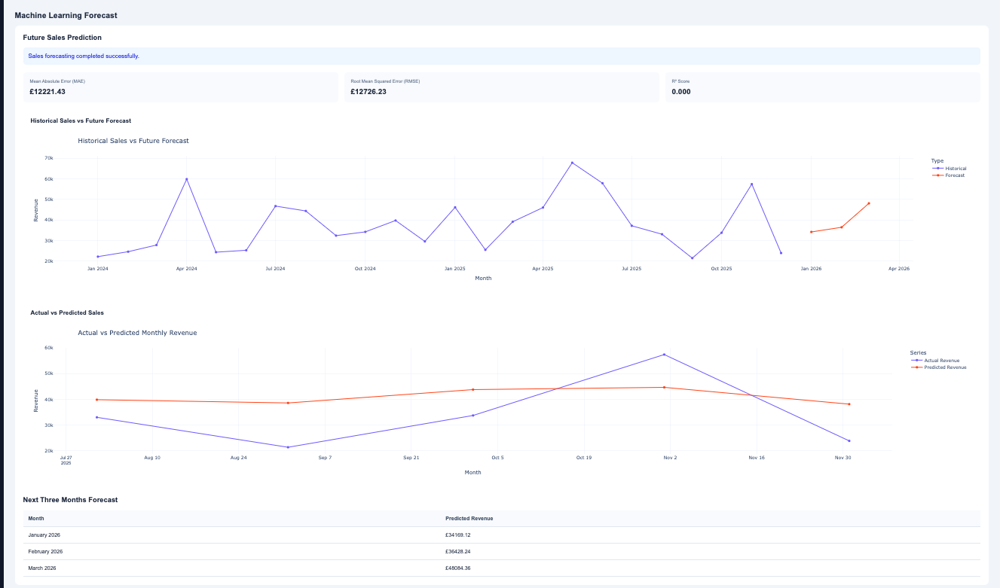

# Sales Analytics & Forecasting System

A Python Flask-based web application for analyzing business sales performance and forecasting future revenue using Machine Learning.

## Project Overview

The Sales Analytics & Forecasting System helps businesses monitor revenue, profit, product performance, and regional sales through an interactive dashboard.

It also uses a Random Forest Regression model to forecast sales for the next three months based on historical sales data.

## Features

- Interactive sales analytics dashboard
- Revenue and profit tracking
- Total orders and products sold
- Best-selling product identification
- Profit margin calculation
- Date, region, and category filters
- Six interactive Plotly visualizations
- CSV sales data upload
- Historical sales analysis
- Three-month sales forecasting
- Actual vs Predicted comparison
- Model evaluation using MAE, RMSE, and R²

## Technologies Used

- Python
- Flask
- MySQL
- Pandas
- NumPy
- Scikit-learn
- Plotly
- HTML
- CSS

## Machine Learning

The project uses Random Forest Regression to predict future monthly revenue.

Model evaluation metrics:

- Mean Absolute Error (MAE)
- Root Mean Squared Error (RMSE)
- R² Score

The model requires sufficient historical monthly sales data. Forecast results are estimates and should not be treated as guaranteed business outcomes.

## Dashboard Screenshots

### Business Overview

### Sales Analysis

### Machine Learning Forecast

## Project Structure

sales-analytics-system/
│
├── app/
│   ├── __init__.py
│   ├── models.py
│   ├── routes.py
│   ├── templates/
│   │   ├── base.html
│   │   └── dashboard.html
│   └── static/
│       └── style.css
│
├── data/
│   └── sample_sales.csv
│
├── ml/
│   └── forecasting.py
│
├── config.py
├── run.py
├── requirements.txt
├── .env.example
├── .gitignore
└── README.md

## Installation and Setup

### 1. Clone the repository

git clone YOUR_GITHUB_REPOSITORY_URL

cd sales-analytics-system

### 2. Create a virtual environment

python3 -m venv venv

### 3. Activate the environment

source venv/bin/activate

### 4. Install dependencies

pip install -r requirements.txt

### 5. Configure environment variables

Create a `.env` file using `.env.example` as a reference.

Add your own MySQL database credentials.

### 6. Create the MySQL database

CREATE DATABASE sales_analytics;

### 7. Run the application

python run.py

### 8. Open the dashboard

http://127.0.0.1:5000/

## Future Enhancements

- Advanced forecasting algorithms
- Automated report generation
- User authentication
- Cloud deployment
- Real-time sales monitoring

## Author

Badda Dilleswara Rao

GitHub: https://github.com/dilleswararao18

LinkedIn: https://www.linkedin.com/in/dilleswara-rao-badda/
